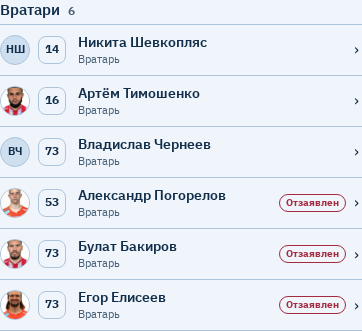
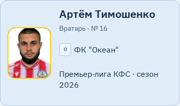

# Портреты ФК «Океан» (Керчь) в Премьер-лиге КФС 2026

Импорт охватил сезонные записи «Океана» из `rostersByTeamId["cfu:team:fc-okean"].entries`, включая всех игроков с отметкой «Отзаявлен». У каждого профиля сверили официальный ID и проверили портрет в `playerProfile-header`. [Официальный состав на сайте КФС](https://www.cfu2015.com/teams/fc-okean/).

| Показатель | Количество |
| --- | ---: |
| Сезонные записи | 45 |
| Уникальные игроки | 45 |
| Сохранённые отзаявки | 21 |
| Портреты до импорта | 0 |
| Проверенные официальные профили | 45 |
| Найденные и проверенные настоящие фотографии | 42 |
| JPEG, добавленные в Git и указанные в обоих JSON | 42 |
| Игроки с инициалами | 3 |
| Профили с заглушкой | 3 |
| Ошибки импорта | 0 |

Импорт занял **59 мин 40 с** 18 ноября 2026 года, с 13:43:29 до 14:43:09 МСК. Запросы выполнялись последовательно с проверкой `robots.txt` и интервалом не менее 40 секунд. Для каждого загруженного оригинала проверены MIME, формат JPEG, размеры и SHA-256.

Инициалы остались у Никиты Шевкопляса (`2168`), Владислава Чернеева (`2167`) и Рауля Муртазаева (`2040`). У трёх игроков с регистрациями в нескольких клубах сохранены единые ID КФС (`1782`, `2032`, `803`) и все их клубные записи.

## Возобновление

```sh
python -m scripts.cfu_player_photos --team cfu:team:fc-okean --publish --retry-failed
```

Импортёр записывает прогресс после каждого игрока в `_state/cfu-player-photos/fc-okean.json`. Повторный запуск сверил сохранённые JPEG по SHA-256 и завершился без сетевых запросов. Контрольная точка «Таврии» сохранилась побайтно.

В `cfu-premier-rosters-2026.json` и `docs/cfu-premier-rosters-2026/rosters.json` добавлены одинаковые метаданные `photo`. PWA читает фотографии из `assets/cfu-player-photos/<id>/<sha256>.jpg` через существующий интерфейс. Инициалы отображаются при отсутствии фото, ошибке загрузки или холодном открытии портрета офлайн.

## Проверки

- Обе копии JSON совпадают побайтно. В Git и в локальной сборке Pages сверены SHA-256 всех указанных JPEG. Сохранены все 32 фотографии «Таврии» и все сезонные регистрации, включая 21 отзаявку «Океана» и девять отзаявок «Таврии». Данные РФФК совпадают с `main`.
- Офлайн-проверка повторного импорта составов подтвердила перенос портретов по официальным ID.
- `python -m unittest discover -s tests -v` — 228 тестов. `node --test tests/*.test.cjs` — 196 тестов. `git diff --check` — без замечаний.
- Chromium — 320, 390 и 768 px в светлой и тёмной темах. Проверены реальные JPEG, круглые аватары 30 × 30, большие портреты, номер, позиция, клуб и ссылка на КФС. Проверены переходы из состава, прямой вход в профиль и инициалы при отсутствии фото, HTTP 404 и офлайн.
- Главная не запрашивает портреты КФС. Проверка ленивой отрисовки подтвердила сохранение поведения пяти вкладок.
- [Проверки GitHub Actions для ветки](https://github.com/dancharms9-commits/fk-sudak/actions/workflows/check.yml?query=branch%3Afeature%2Fcfu-okean-player-photos).

## Скриншоты Chromium

[Полный состав на 390 px, светлая тема](okean-player-photos/after-full-roster-390-light.png).

| Ширина | Тема | Состав | Профиль Артёма Тимошенко |
| ---: | --- | --- | --- |
| 320 | Светлая | [Состав](okean-player-photos/after-roster-320-light.png) | [Профиль](okean-player-photos/after-profile-320-light.png) |
| 320 | Тёмная | [Состав](okean-player-photos/after-roster-320-dark.png) | [Профиль](okean-player-photos/after-profile-320-dark.png) |
| 390 | Светлая |  |  |
| 390 | Тёмная | [Состав](okean-player-photos/after-roster-390-dark.png) | [Профиль](okean-player-photos/after-profile-390-dark.png) |
| 768 | Светлая | [Состав](okean-player-photos/after-roster-768-light.png) | [Профиль](okean-player-photos/after-profile-768-light.png) |
| 768 | Тёмная | [Состав](okean-player-photos/after-roster-768-dark.png) | [Профиль](okean-player-photos/after-profile-768-dark.png) |
