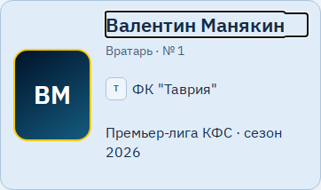
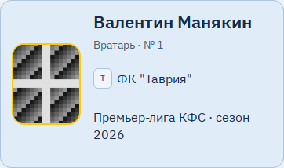
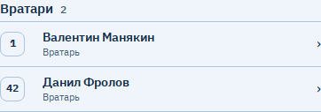
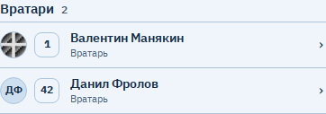

# Фотографии футболистов Премьер-лиги КФС 2026

В текущем снимке 238 уникальных игроков, 253 сезонные записи и семь клубов. 18 ноября 2026 года выборочно проверены пять профилей. Четыре фотографии подтверждены по профилю и открываются по HTTPS. Разрешение на их показ в PWA пока не подтверждено. В публикуемом снимке 238 игроков с инициалами и 0 фотографий.

## Что публикует КФС

На проверенных страницах собственная ссылка профиля стоит в `.pageTitle section > strong > a[href]`. Изображение находится в `.playerProfile-header .playerProfile-header-content > .photo > img`, URL задан через `src`. Фото-файлы отдаются на `https://img.cfu2015.com/i/rectangle/286x380/` как `image/jpeg`, без перенаправлений. У всех четырёх снимков размер 286 × 380, объём от 28 887 до 35 130 байт. В заглушке `src` указывает на `/content/themes/cfu2/images/noPeoplePhoto.svg`. Герб находится в отдельном блоке `.logo`, а `og:image` в проверенном профиле Манякина ведёт на общую картинку сайта.

| Профиль | Клуб в снимке 2026 | Результат |
| --- | --- | --- |
| [Валентин Манякин, ID 258](https://www.cfu2015.com/players/258/) | Таврия | `manyakin_valentin_20250411.jpg` |
| [Никита Шевкопляс, ID 2168](https://www.cfu2015.com/players/2168/) | Океан | Заглушка `noPeoplePhoto.svg` |
| [Сергей Дусенко, ID 2061](https://www.cfu2015.com/players/2061/) | Ялта | `dusenko_sergey_20260403.jpg` |
| [Олег Коваленко, ID 1803](https://www.cfu2015.com/players/1803/) | Феодосия | `kovalenko_oleg_20260327.jpg` |
| [Дмитрий Донцов, ID 1710](https://www.cfu2015.com/players/1710/) | Спарта-КТ | `doncov_dmitriy_20260327.jpg` |

| Диагностика | Игроки |
| --- | ---: |
| Всего | 238 |
| Проверено | 5 |
| Найдено и проверено по формату | 4 |
| Подтверждено и разрешено к показу | 0 |
| Отсутствует блок изображения | 0 |
| Опубликована заглушка | 1 |
| Ошибки загрузки | 0 |
| Неоднозначные соответствия | 0 |
| Отклонённые URL | 0 |
| Права на публикацию не подтверждены | 4 |
| Остальные профили пока не проверены | 233 |

## Права и ограничения

Подвал сайта КФС допускает использование материалов, включая фотографии, при наличии прямой индексируемой ссылки на главную сайта КФС в первом абзаце текста. Для материалов из вторичных источников требуется указание первоисточника. Ссылка на персональный профиль в приложении указывает происхождение снимка. Условия отдельно не описывают карточки PWA, хранение копий на GitHub Pages и разрешения КФС на портреты, полученные от клубов. Источник публикации и автор фотографии могут различаться. [Условия в подвале сайта КФС](https://www.cfu2015.com/).

Перед добавлением снимков нужно получить от КФС или соответствующего правообладателя подтверждение по конкретным портретам либо по определённому перечню официальных профилей и версий снимков. В подтверждении нужны разрешение на хранение и показ локальных копий в PWA на GitHub Pages, условия кадрирования, требуемая ссылка и формулировка подписи. Если правообладатель предлагает хотлинкинг, его условия требуют отдельного подтверждения. Контакт КФС указан в подвале сайта как `info@cfu2015.com`. [Официальный сайт КФС](https://www.cfu2015.com/).

`robots.txt` основного домена разрешал `/players/` и задавал интервал 40 секунд. Запрос `robots.txt` у домена изображений вернул 404. Импортёр выдерживает минимум 40 секунд между всеми запросами, включая проверку обоих robots-файлов, и учитывает больший указанный интервал. Некорректный ответ основного robots-файла, запрет пути или редирект блокирует запрос. Полный обход может потребовать около 478 запросов и более пяти часов. Проверку запускают вручную небольшими партиями в отдельное от обновления КФС время. [robots.txt КФС](https://www.cfu2015.com/robots.txt).

## Импорт и хранение

```sh
python -m scripts.cfu_player_photos --ids 258 2168 2061 --limit 3
python -m scripts.cfu_player_photos --report-only
```

Состояние по каждому ID сохраняется сразу в `_state/cfu-player-photos/audit.json`. Повторный запуск пропускает сохранённые результаты. Без `--ids` берётся следующая партия, по умолчанию три ID, максимум десять за запуск. `--retry-failed` разрешает повторить сетевые ошибки, а `--ids … --recheck` проверяет конкретные профили заново. Проверка выполняется последовательно. Команда отчёта читает контрольные точки без запросов.

Парсер сверяет официальный ID в URL и заголовке профиля. Он берёт только портрет из указанного блока и может прочитать `data-src`, если он опубликован там. Разные варианты источника и одинаковый URL или контрольная сумма у разных ID требуют ручной проверки. Разрешён только точный HTTPS-путь к JPEG на домене изображений КФС. Серверный ответ проверяется по MIME, заголовкам JPEG, размеру изображения 32–512 пикселей на сторону и лимиту 256 КиБ. Все остальные форматы отклоняются. Скачанные для аудита байты проверяются в памяти.

После получения прав и визуальной сверки оператор в отдельном JSON указывает объект по ключу `cfu:player:<id>` с полями `imageUrl`, `sha256` и `permission` со ссылкой на подтверждение. URL и SHA-256 должны совпадать с последней успешной проверкой этого профиля. Проверяющий должен также учесть любые условия подписи из разрешения перед включением конкретных снимков.

```sh
python -m scripts.cfu_player_photos --permissions /path/to/permissions.json --publish --ids 258
```

Эта команда готовит локальные файлы для ревью. Она повторно сверяет контрольную сумму, сохраняет файл как `assets/cfu-player-photos/<id>/<sha256>.jpg` и добавляет `photo` с полями `status: approved`, `sourceUrl`, `imageUrl`, `sha256` у игрока в `playersById` в обеих копиях снимка. Регистрации и отзаявки остаются привязанными к клубам. Ошибка одной проверки оставляет действующие снимки и прежние утверждённые фотографии. Обычный импорт составов переносит утверждённое фото по тому же ID. Для отзыва разрешения удаляют поле в обеих копиях и соответствующий локальный файл перед ревью. Старые снимки без `photo` совместимы с форматом версии 1.

## Отображение и проверка

В профиле фото занимает существующий большой аватар, рядом с источниками появляется ссылка на официальный профиль. В составе клуба фото обрезается по круглому аватару 30 × 30 с `object-fit: cover`. Инициалы видны до загрузки, при отсутствии фото и при ошибке. Строки с номером и отметкой «Отзаявлен» сохраняются.

Изображения запрашиваются с того же сайта, что и PWA. Состав использует `loading="lazy"` и `decoding="async"`. Главная и неоткрытые вкладки портретов не запрашивают. При офлайн-перезагрузке недоступное изображение уступает место инициалам. Service Worker использует обычный кэш ранее загруженных файлов, обязательный precache не меняется.

Локальные проверки запускаются через `python -m unittest discover -s tests -v`, `node --test tests/*.test.cjs` и `git diff --check`. Chromium в GitHub Actions проверяет состав и профиль на ширинах 320, 390 и 768 px в двух темах, переходы из состава и центра матча, прямые ссылки, обновление, ошибку фото и перезагрузку офлайн. Проверка РФФК и ленивая отрисовка дополнительно покрыты существующими тестами. Артефакт `cfu-player-photos-screenshots` содержит снимки `before-*` и `after-*` для каждой пары ширины и темы. На кадрах с включённым фото показан геометрический тестовый образец.

Локально прошли 226 тестов Python, 196 тестов Node и `git diff --check`. [Проверки PR и полная матрица скриншотов Chromium](https://github.com/dancharms9-commits/fk-sudak/pull/49/checks).

### Кадры Chromium на 390 px в светлой теме

| Экран | До | После с тестовым изображением |
| --- | --- | --- |
| Профиль |  |  |
| Состав |  |  |
