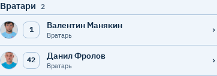
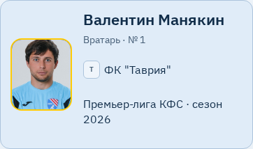

# Портреты «Таврии» в Премьер-лиге КФС 2026

В импорт вошёл сезонный состав ФК «Таврия» (Симферополь), включая футболистов с отметкой «Отзаявлен». Источник портретов — разделы профилей игроков на официальном сайте. [Крымский футбольный союз](https://www.cfu2015.com/).

| Показатель | Количество |
| --- | ---: |
| Сезонные записи «Таврии» | 32 |
| Уникальные игроки | 32 |
| Сезонные записи с отзаявкой | 9 |
| Опубликованные портреты до импорта | 0 |
| Проверенные официальные профили | 32 |
| Найденные и проверенные настоящие JPEG | 32 |
| JPEG, добавленные в Git и в оба JSON | 32 |
| Игроки с инициалами | 0 |
| Профили с заглушкой | 0 |
| Профили без блока фото | 0 |
| Профили с нерешённой ошибкой проверки | 0 |

Обход занял 57 мин 41 с, 18 ноября 2026 года с 12:03:10 до 13:00:51 МСК. Запросы шли последовательно с интервалом не менее 40 секунд. Доступ проверялся по robots.txt. После девяти сетевых таймаутов повторный проход успешно загрузил оставшиеся JPEG. [Состав «Таврии» на сайте КФС](https://www.cfu2015.com/teams/tavriya/).

Для каждого JPEG сверены ID в заголовке официального профиля и адрес портрета в блоке `playerProfile-header`.

## Возобновление и обновление

```sh
python -m scripts.cfu_player_photos --team cfu:team:tavriya --publish --retry-failed
```

Команда читает `_state/cfu-player-photos/tavriya.json` и пропускает проверенные ID с сохранёнными JPEG. Контрольная точка записывается после каждого игрока. Фотографии `assets/cfu-player-photos/<id>/<sha256>.jpg` привязаны к официальным профилям в `cfu-premier-rosters-2026.json` и `docs/cfu-premier-rosters-2026/rosters.json`. Использование официальных портретов в проекте подтвердил представитель КФС.

Для замены портрета Манякина запустите `python -m scripts.cfu_player_photos --team cfu:team:tavriya --publish --ids 258 --recheck`. Ошибка проверки сохраняет действующий портрет. Для удаления уберите поле `photo` из обеих копий JSON и соответствующий JPEG. Обычный импорт составов переносит существующий портрет по ID игрока. Четыре футболиста, заявленные за несколько клубов, используют фото в общем профиле.

## Проверки

- Python, 227 тестов прошли — `python -m unittest discover -s tests -v`.
- Node, 196 тестов прошли — `node --test tests/*.test.cjs`.
- `git diff --check` прошла.
- Chromium, 320, 390 и 768 px в светлой и тёмной темах. Проверены реальные JPEG, круглые аватары 30 × 30, большой портрет, ссылка на КФС, переходы из состава и прямая ссылка. При отсутствии файла, ошибке загрузки и холодной загрузке портрета офлайн видны инициалы. Главная не запрашивает портреты игроков КФС.
- Сверены SHA-256 и JPEG в репозитории и в сборке Pages. Оба JSON совпадают побайтно. Сезонные записи всех клубов, девять отзаявок и данные РФФК сохранены.
- GitHub Actions. [Четыре задания проверки PR](https://github.com/dancharms9-commits/fk-sudak/pull/50/checks).

## Скриншоты Chromium

[Полный состав на 390 px, светлая тема](tavriya-player-photos/after-full-roster-390-light.png).

| Ширина | Тема | Состав | Профиль Валентина Манякина |
| ---: | --- | --- | --- |
| 320 | Светлая | [Состав](tavriya-player-photos/after-roster-320-light.png) | [Профиль](tavriya-player-photos/after-profile-320-light.png) |
| 320 | Тёмная | [Состав](tavriya-player-photos/after-roster-320-dark.png) | [Профиль](tavriya-player-photos/after-profile-320-dark.png) |
| 390 | Светлая |  |  |
| 390 | Тёмная | [Состав](tavriya-player-photos/after-roster-390-dark.png) | [Профиль](tavriya-player-photos/after-profile-390-dark.png) |
| 768 | Светлая | [Состав](tavriya-player-photos/after-roster-768-light.png) | [Профиль](tavriya-player-photos/after-profile-768-light.png) |
| 768 | Тёмная | [Состав](tavriya-player-photos/after-roster-768-dark.png) | [Профиль](tavriya-player-photos/after-profile-768-dark.png) |
