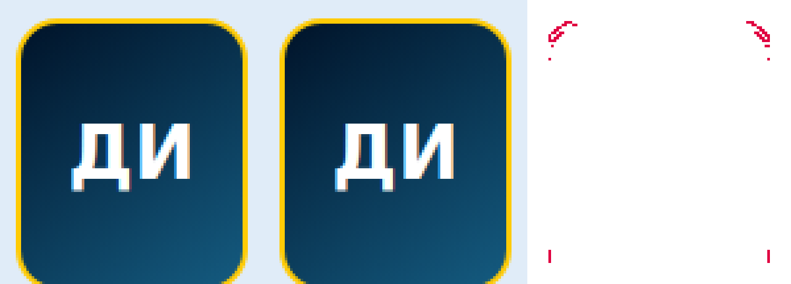

# PR #35: различия растра старого профиля «Судака»

Исходный сбой: [Actions 42875371878](https://github.com/dancharms9-commits/fk-sudak/actions/runs/42875371878), commit `f6b0dee87506f5727360086da0aad27364514577`. Скачан оригинальный artifact `launch-screenshots` (ID `13791462746`). [До](ci-before.png) и [после](ci-after.png) — неизменённые файлы из этого artifact; SHA-256 и **все 62 координаты с RGBA** находятся в [ci-pixels.json](ci-pixels.json). Эти файлы служат диагностикой, тест не использует их как эталоны.



Координаты отсчитываются от верхнего левого угла PNG, с нуля; viewport 390×844, DPR 1. Ограничивающий прямоугольник отличий: **x=31…114, y=184…275**. Из 62 пикселей 29 имеют дельту >2; у остальных 33 она равна 1–2. Максимум 36 в `(109,185)`: `[241,217,111,255] → [237,222,147,255]`. За пределами этой области весь кадр совпадает.

| y | x всех отличающихся пикселей |
| ---: | --- |
| 184 | 37, 38, 39, 106, 107, 108 |
| 185 | 36, 37, 40, 41, 108, 109 |
| 186 | 34, 35, 110, 111 |
| 187 | 33, 34, 111, 112 |
| 188 | 32, 33, 35, 36, 109, 110, 112, 113 |
| 189 | 31, 34, 35, 110, 111, 113, 114 |
| 190 | 31, 33, 34, 111, 112, 114 |
| 191 | 31, 32, 33, 112, 113, 114 |
| 193 | 32, 113, 114 |
| 198 | 31, 114 |
| 271–275 | 31, 114 на каждой строке |

Все отличия принадлежат сглаживанию контура **`#player > .player-hero > .player-avatar`** в старом профиле **Донского Ильи**, `#player=rffk-202&from=home`. В локальном воспроизведении прямоугольник элемента: `x=29, y=182.8125, width=88, height=104`. Элемент содержит только `<span aria-hidden="true">ДИ</span>`, без изображения. Инициалы совпадают; изменяются пиксели контура фона под золотой рамкой. Прежнее CSS-правило в `index.html`:

```css
.player-avatar {
  border-radius: 16px;
  overflow: hidden;
  background: linear-gradient(145deg, var(--navy), #145B80);
  border: 2px solid var(--sun);
}
```

`--navy=#001329`, `--sun=#FFCB05`. Правило, переменные, размеры и разметка старого профиля в этом исправлении не меняются.

## Причина и контрольные эксперименты

Это нестабильность сглаживания скруглённого градиентного clip в Chromium при растеризации, зависящей от предыдущих отрисовок. Это не загрузка портрета: изображение в обеих версиях отсутствует, сеть РФФК заблокирована, а локальные ресурсы и шрифты дожидаются готовности. Сравнение геометрии, текста и вычисленных стилей прошло и в исходном CI. Ожидание двух побайтово одинаковых кадров уже было в тесте, но оно проверяло стабильность внутри одного документа и не гарантировало одинаковую растеризацию двух загрузок.

Причина отделена от изменений PR контрольным сравнением **main с теми же байтами main**. Локально прежний тест также получил 59 пикселей, max 35, в той же области. В серии из восьми сравнений main/main два дали это расхождение. Сохранены [main/main до](main-self-before.png), [после](main-self-after.png), [59 координат](main-self-pixels.json). Таким образом, для возникновения эффекта не нужны CSS или JavaScript PR #35. Отдельные чистые browser context также не устранили эффект: в серии base/candidate четвёртая пара снова дала 59 пикселей, max 35. Одна изоляция контекстов поэтому не принята как исправление.

В `chromium.launch()` только этого теста добавлен **`--disable-partial-raster`**: обе версии сравниваются при полной растеризации, без повторного использования частично перерисованных тайлов. [Документация Chrome для инструментов](https://github.com/GoogleChrome/chrome-launcher/blob/main/docs/chrome-flags-for-tools.md#rendering--gpu) описывает эту настройку в группе воспроизводимого рендеринга. Переключение устранило расхождения в 12 последовательных сравнениях base/candidate в отдельных контекстах и ещё в 12 сравнениях с прежним повторным использованием страницы. Во всех 24 парах профиль совпал побайтово. Финальный тест сохраняет прежнюю последовательность маршрутов и повторное использование страницы; меняется только условие растеризации.

Дополнительно выполнен отрицательный контроль: только в памяти диагностического сервера кандидату добавлен `.player-avatar {background-clip:padding-box!important}`. Геометрия и сравниваемые свойства остались одинаковыми, но **PNG-проверка корректно упала**: 109 пикселей, max 55, hardMax 55. Флаг не маскирует настоящее изменение рисования того же элемента. Изменение не записывалось в приложение.

Внутренний дефект конкретной функции Skia этим расследованием не локализован; установлен источник ложного срабатывания на уровне растеризации Chromium и проверено управление условиями теста. Допуски, маска разрешённого сглаживания навигации, проверка `sudak-player` и набор защищённых экранов сохранены. Эталонные снимки не заменяются. При следующем расхождении тест дополнительно сохраняет JSON с версией браузера, архитектурой, точными координатами/RGBA, DOM-классами, геометрией и стилями обеих версий.

## Окружения

| | Исходный CI | Локальная проверка |
| --- | --- | --- |
| ОС / архитектура | Ubuntu 26.04.1, x64 | Android / Termux, ARM64 |
| Node | 22.23.4 | 24.22.2 |
| Chromium | 130.0.6723.31, Playwright build 1140 | 156.0.8078.79, ранее настроенный native headless shell |
| Python | 3.12.16 | 3.14.8 |
| Viewport / DPR | 390×844 / 1 | 390×844 / 1 |
| Источник базы | base SHA PR, `b9be850` | те же байты `main:index.html` |

Различия 62/59 воспроизводят одну область сглаживания в двух версиях браузера. Пакеты и версии CI не обновлялись ради прохождения теста. Флаг применяется одинаково к base/candidate в обоих окружениях; приложение, offline-оболочка и production workflow не менялись.

## Проверки исправления

- `python -m unittest discover -s tests -v`: **136/136**, повтор после изменения теста.
- `node --test tests/*.test.cjs`: **102/102**, повтор после изменения теста.
- `node tests/design-preservation.browser.cjs`: **168/168 пар** (21 защищённый экран × 320/390/768/1440 × светлая/тёмная тема). Все PNG совпали **точно**, дельта 0, включая все восемь вариантов старого профиля и главной. [Полный локальный результат](preservation-local.json).
- Отрицательный контроль `background-clip`: ожидаемый отказ PNG-проверки, 109 пикселей / max 55.
- Повторно побайтово проверены **260 защищённых файлов** против main; отличий нет. `index.html` и код приложения также побайтово совпадают с исходным commit PR #35 `f6b0dee`. Не перезаписан ни один снимок прежнего аудита.

Полный Python/Node/браузерный набор остаётся в существующем workflow [check](../../../../.github/workflows/check.yml). Актуальный результат GitHub Actions для исправления доступен в [проверках PR #35](https://github.com/dancharms9-commits/fk-sudak/pull/35/checks). Production workflow, публикация и объединение PR не выполняются.
