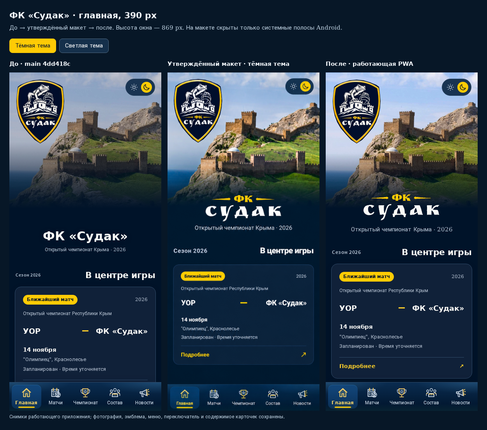

# Главная ФК «Судак» — финальная доработка

Основа — `main` на коммите `4dd418c`, после объединённых PR №25 и №26.
Ветка: `design/sudak-home-final-polish`.

## Оформление по утверждённому макету

Двухстрочная надпись «ФК / СУДАК» повторяет золотые линии и контуры букв из
[пользовательского макета](approved-reference.png). Контуры переведены в лёгкие
SVG-path и встроены прямо в `index.html` — около 5,7 КБ, без web-шрифтов,
библиотек и дополнительных сетевых запросов. Пропорции букв сохранены.
Текстовое имя заголовка «ФК «Судак»» доступно скринридерам. На других вкладках
сохранён обычный текстовый заголовок. В светлой теме тонкий синий контур
обеспечивает читаемость белых и золотых букв на светлом фоне.

Фотография остаётся исходной `assets/home-fortress.jpg`, побайтово совпадающей
с версией в `main`. Только её отдельный псевдоэлемент получает CSS-фильтр:

- тёмная тема: насыщенность 118%, контраст 110%, яркость 106%;
- светлая тема: насыщенность 112%, контраст 108%, без повышения яркости.

Тёмно-синий слой уменьшен примерно с 14% до 4%. Переход в цвет страницы вынесен
в отдельный слой, который не фильтруется. Эмблема, заголовок, меню, переключатель
и карточки не получают фильтров. Кадрирование крепости из PR №25 сохранено
независимо от высоты шапки: башни не перекрываются эмблемой.

Вертикальная композиция подобрана по последнему макету. На 390 px верх карточки
ближайшего матча находится на 491 px от начала приложения; в макете — около
493 px после исключения системной полосы Android. Высота шапки адаптивная,
без фиксированных сдвигов элементов. Внутренние размеры и содержимое карточек
сохранены. Под заголовком остаётся «Открытый чемпионат Крыма · 2026».

Размеры и координаты эмблемы, нижнего меню и переключателя тем совпадают с
исходными во всех восьми вариантах. Все скрипты приложения побайтово сохранены.
Не изменены фотография и эмблема, карточки и данные матчей, статистика,
профили, чемпионат, новости, парсеры, JSON, кэши, навигация, SW, manifest,
PWA, GitHub Actions и Pages. Две удалённые в PR №26 надписи не возвращены.

## Сравнение с макетом

[Тёмная тема — до / макет / после](comparison-dark.png).
[Светлая тема — до / макет / после](comparison-light.png).
[HTML-сравнение с переключением снимков](comparison.html).

Утверждённый макет предоставлен только в тёмной теме; в светлом сравнении
он остаётся таким же. В сравнении визуально скрыты только системные полосы
Android на исходном макете. Сам файл макета сохранён без изменений.

## Скриншоты до и после

Снимки сняты одним локальным Chromium, при масштабе 1, после загрузки фотографии
и шрифтов и окончания анимаций. Ширины — 320, 390, 768 и 1440 px, обе темы.
Высота — 844 px; для 390 px — 869 px, чтобы сравнить приложение с областью
макета между системными полосами Android. Время выбора матча зафиксировано
в контексте браузера на 2026-11-05 10:00 UTC. Данные проекта не изменялись.
Для чистого сравнения Service Worker блокировался только при съёмке;
настоящий офлайн проверялся отдельно существующими браузерными тестами.

| Экран | Тёмная: до | Тёмная: после | Светлая: до | Светлая: после |
| --- | --- | --- | --- | --- |
| 320 px | [до](before/320-dark.png) | [после](after/320-dark.png) | [до](before/320-light.png) | [после](after/320-light.png) |
| 390 px | [до](before/390-dark.png) | [после](after/390-dark.png) | [до](before/390-light.png) | [после](after/390-light.png) |
| 768 px | [до](before/768-dark.png) | [после](after/768-dark.png) | [до](before/768-light.png) | [после](after/768-light.png) |
| 1440 px | [до](before/1440-dark.png) | [после](after/1440-dark.png) | [до](before/1440-light.png) | [после](after/1440-light.png) |

[Геометрия до](before/layout.json) и [после](after/layout.json) включает шапку,
эмблему, заголовок, карточки, меню и переключатель. Дополнительно в браузере
сравнены исходные HTML-шаблоны всех блоков главной, проверено доступное имя
заголовка, отсутствие фильтров у элементов интерфейса, пустых предупреждений,
наложений заголовка на эмблему и горизонтального переполнения.

## Проверки

- `python -m unittest discover -s tests -v` — 65 тестов успешно.
- `node --test tests/*.test.cjs` — 65 тестов успешно.
- `node tests/browser.cjs` — успешно: четыре ширины, обе темы и режимы движения,
  41 профиль, 16 протоколов, фильтры, ссылки/история/фокус/прокрутка,
  проверенные и отсутствующие данные, PWA, настоящий офлайн и восстановление сети.
- `node tests/home-dashboard.browser.cjs` — успешно: главная, данные и переходы,
  настоящий SW и офлайн; также запускается полный `tests/themes.browser.cjs`
  со всеми пятью вкладками, панелями чемпионата и сохранением темы.
- Дополнительная браузерная проверка 320/390/768/1440 × обе темы — доступный
  заголовок, фильтр только фотографии, совпадение эмблемы/меню/переключателя,
  размеров и содержимого карточек. Ошибок JavaScript и переполнения нет.
- Все `<script>` приложения совпадают с `main`; CSS встроен без расхождений;
  фото, эмблема, JSON, manifest и SW совпадают побайтово.
- Разбор CSS и `git diff --check` — успешно.

В Termux использовались существующие Playwright (`PLAYWRIGHT_MODULE`), локальный
Chromium (`CHROMIUM_EXECUTABLE_PATH`) и адаптер платформы Node через `--import`.
Один параллельный запуск проверки главной получил локальный таймаут офлайн-
перезагрузки; повтор после завершения общего браузерного набора прошёл полностью.

## Изменённые файлы

- `index.html` — разметка доступного заголовка с SVG и встроенная копия CSS.
- `modern-home.css` — только оформление главной: фон, заголовок и отступы.
- `docs/home-final-polish/README.md` — описание, проверки и каталог снимков.
- `docs/home-final-polish/approved-reference.png` — исходный утверждённый макет.
- `docs/home-final-polish/comparison.html` — локальное сравнение снимков.
- `docs/home-final-polish/comparison-dark.png`, `comparison-light.png` — сравнения.
- `docs/home-final-polish/before/` и `after/` — по восемь PNG из таблицы выше
  и `layout.json` с результатами измерений.
