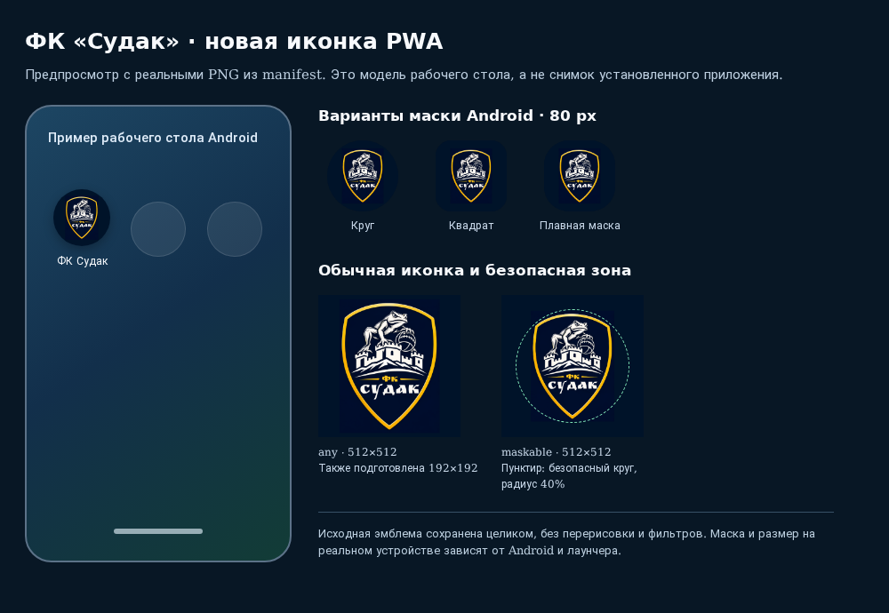

# Установочная иконка ФК «Судак» для Android

PR №27 уже объединён. Изменение подготовлено в отдельной ветке
`fix/android-pwa-launcher-icon` от `main` (`ce23822`).

Использован точный файл пользователя `sudak_B_font2_old_rus.png`:
он побайтово совпадает с уже имеющимся `assets/home-crest-original.png`.
SHA-256 оригинала:
`a423ec7fa499ae42bbf6b85e00213bb5034e871e6ae845256e8774b43104673c`.
Повторная копия оригинала в репозиторий не добавлялась.

Щит, лягушка, окантовка и надписи сохранены. Иконки подготовлены только
пропорциональным уменьшением полного оригинала на непрозрачном тёмно-синем
поле. Перерисовки, обрезки эмблемы и цветовых фильтров нет.

| Файл | Размер | Назначение |
| --- | --- | --- |
| [Обычная 192](../../assets/pwa-launcher/crest-any-192-9297226bb1a7.png) | 192 × 192 | `any` |
| [Обычная 512](../../assets/pwa-launcher/crest-any-512-5aaab8386f21.png) | 512 × 512 | `any` |
| [Maskable 512](../../assets/pwa-launcher/crest-maskable-512-ad8a6296949e.png) | 512 × 512 | `maskable` |

Обычные версии используют 94% высоты квадрата, maskable — 78%.
Все важные части эмблемы помещаются внутри центрального круга радиуса 40%
ширины. Проверены пиксели внешней белой/жёлтой окантовки, охватывающей остальную
эмблему. Поле вокруг щита допускает обрезку различными масками Android;
сам щит и надписи остаются видны.
Это соответствует [правилам безопасной зоны maskable](https://web.dev/articles/maskable-icon).

## Предпросмотр

[Открыть HTML-предпросмотр](preview.html).
Использованы реальные PNG из текущего manifest, в том числе круглая и две
скруглённые маски. Это модель рабочего стола, не аппаратный скриншот.
В этой среде не обнаружены ADB, `rish` или инструмент управления устройством;
установка и отображение в конкретном Android-лаунчере ещё не проверены.
Маска и конечный размер зависят от устройства и лаунчера.

## Обновление существующей установки

Изменены только три `icons[].src` в `manifest.json`. Остальные поля manifest,
его имя и ссылка `rel="manifest"` сохранены. Новые имена PNG включают
12 символов SHA-256 содержимого. Старые установочные URL не переиспользуются.
Это позволяет загрузить новые файлы поверх прежнего кэша, сохранив
идентичность установленного приложения.

Chrome 144+ определяет изменение иконок по их URL/метаданным; при существенной
смене значка может потребоваться подтверждение пользователем. Поэтому
обновление manifest не означает немедленную смену значка без участия Chrome.
См. [обновления web app в Chrome 144+](https://developer.chrome.com/blog/improvements-to-web-app-updates).

После ручного объединения PR и публикации Pages:

1. Открыть существующую PWA с доступом в сеть и затем закрыть её.
2. Если Chrome предлагает `Review app update`, подтвердить смену значка.
3. Проверить значок на рабочем столе. Если он прежний, в Chrome можно проверить
   состояние установки на `about://webapks`; при наличии кнопки обновления
   использовать её. Для старых версий Chrome проверить Wi-Fi и зарядку,
   закрыть PWA, запланировать обновление через эту страницу и снова открыть/закрыть
   приложение. [Инструкция Chrome для Android](https://web.dev/articles/manifest-updates).

Ручная переустановка не выполнялась, данные и ярлыки на устройстве не удалялись.
Не обещается фиксированный срок обновления иконки в Android: его определяет браузер.

## Границы изменения

- `index.html`, `modern-home.css`, эмблемы внутри приложения, фото крепости,
  карточки, темы, меню, статистика, профили, маршруты и данные не изменены.
- Старые `icon-*.png`, `fk-sudak-pwa-*.png`, favicon и apple-touch-icon оставлены
  прежними: они используются внутри приложения и не заменяются вместе с launcher.
- `name`, `short_name`, `start_url`, `scope`, `display`, цвета, язык и описание
  manifest сохранены. `id` или новые настройки установки не добавлялись.
- `sw.js` побайтово сохранён. Его существующий network-first режим обновляет
  manifest и сохраняет новые PNG после загрузки. Для новых URL не требуется
  менять версию SW или его обработчики.
- `apply_visual_refresh.py` сохраняет корректный существующий набор иконок,
  чтобы ручной повтор старой миграции не вернул прежние launcher-URL. Миграция
  старого неполного manifest по-прежнему работает и проверена тестом.
- GitHub Actions и Pages не изменены. Новый браузерный тест вызывается из
  существующего `tests/browser.cjs`. Документация исключена текущей сборкой Pages.

## Генерация и проверки

`node scripts/generate-pwa-launcher-icons.cjs` повторно создаёт только launcher-PNG
и обновляет только `manifest.icons`. Оригинал проверяется по SHA-256.
Повторная генерация даёт те же PNG, хэши, URL и manifest.

- `python -m unittest discover -s tests -v` — 66 тестов успешно.
- `node --test tests/*.test.cjs` — 65 тестов успешно.
- `node tests/browser.cjs` — успешно: существующий интерфейс, 41 профиль,
  16 протоколов, обе темы, четыре ширины, SW/офлайн; включает новый тест launcher.
- `node tests/pwa-launcher.browser.cjs` — дополнительно успешно после уточнения
  отступов финальной maskable-иконки. Размеры, непрозрачность, полное исходное
  изображение и каждый пиксель сравниваются с независимым восстановлением из
  оригинала; максимум расхождения — ноль. Проверены хэши имён файлов,
  безопасная зона и неизменность установочных полей.
- Настоящий SW проверен со старым manifest, заранее положенным в кэш: из сети
  приходит новый manifest с новыми URL; после их загрузки manifest и все три
  PNG доступны побайтово точно без сети.
- Финальный набор дополнительно прошёл шесть Python-проверок ресурсов и старой
  миграции. `git diff --check` — успешно.

Для Termux использованы уже установленные Playwright и Chromium через
`PLAYWRIGHT_MODULE`, `CHROMIUM_EXECUTABLE_PATH` и адаптер Node `--import`.
Аппаратная установка Android/WebAPK не эмулируется этими проверками.
